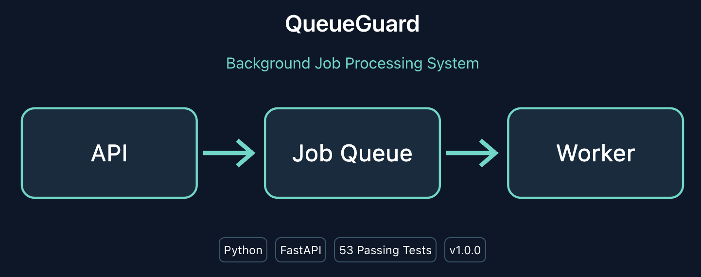
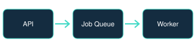
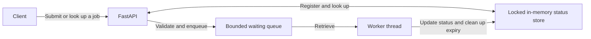

# QueueGuard



QueueGuard is a Python/FastAPI portfolio prototype for accepting validated,
payment-shaped jobs and observing their background processing. It explores
how to separate request acceptance from execution, reject excess waiting
work, isolate processing failures and expire old job statuses.

The processor is a deterministic local placeholder. It performs no payment
charging, network requests or permanent business operations. A `completed`
status means only that the placeholder returned successfully.

## Core functionality

- Validated job submission with UUID job IDs and a 4 KiB request-body limit.
- A configurable bounded waiting queue with immediate overload rejection.
- One lifespan-managed worker thread per application instance.
- Observable `queued`, `processing`, `completed` and `failed` states.
- Configurable terminal-status retention with expiry-aware lookup and
  periodic cleanup in the existing worker thread, including while idle.
- Automated coverage for validation, overload, failures, concurrency,
  application isolation, retention and shutdown.

## Technology stack

Python's standard-library `queue.Queue`, threading primitives and monotonic
clock provide the in-process infrastructure. Direct dependencies are pinned:

| Purpose | Packages |
| --- | --- |
| API and validation | FastAPI 0.111.0, Pydantic 2.10.0, Starlette 0.37.2 |
| ASGI server | Uvicorn 0.30.1 |
| Testing | pytest 8.2.2, HTTPX 0.27.0 |

`requirements.txt` declares runtime dependencies. `requirements-dev.txt`
includes runtime and test dependencies. Both use the transitive pins in
`constraints.txt`, including dependencies required by FastAPI itself.

## Architecture and lifecycle





Each `create_app()` call owns an independent queue, status store and worker.
The API acknowledges accepted submissions with `queued`. The worker changes
stored state through `queued → processing → completed` or
`queued → processing → failed`. It can advance the state before the client
receives the submission response.

## Installation

The verified environment is **CPython 3.13.3 on macOS**. Other Python
versions and platforms have not been verified.

```sh
git clone https://github.com/Giftyaning/QueueGuard.git
cd QueueGuard
python3 --version
python3 -m venv .venv
source .venv/bin/activate
python -m pip install -r requirements-dev.txt
python -m pip check
```

Use a Python 3.13.3 interpreter for the verified setup. For application-only
installation, use `python -m pip install -r requirements.txt` instead.

## Start the application

Run from the repository root with the virtual environment activated:

```sh
python -m uvicorn app.main:app --host 127.0.0.1 --port 8000 --workers 1
```

Use one server process. Interactive API documentation is available at
[http://127.0.0.1:8000/docs](http://127.0.0.1:8000/docs), with the OpenAPI
schema at [http://127.0.0.1:8000/openapi.json](http://127.0.0.1:8000/openapi.json).

## API examples

Run these commands in another terminal with Python available. Response UUIDs
below are illustrative; the commands extract the actual ID from submission.

### Health check

```sh
curl -sS http://127.0.0.1:8000/health
```

HTTP `200`:

```json
{"status":"ok"}
```

This is a process-liveness endpoint. It does not report worker progress.

### Submit a job

```sh
RESPONSE=$(curl -sS -X POST http://127.0.0.1:8000/jobs \
  -H 'Content-Type: application/json' \
  -d '{"payment_reference":"PAY-123","amount":2500,"currency":"GBP","order_id":"ORD-001"}')
printf '%s\n' "$RESPONSE"
```

HTTP `201`:

```json
{"job_id":"71c93ef4-267d-45b2-908b-efc4bdb740f5","status":"queued"}
```

Payment references and order IDs must be 1–128 characters after surrounding
whitespace is stripped. `amount` is validated as a positive integer using
Pydantic's default type coercion. Supported currencies are `GBP`, `USD` and
`EUR`; lowercase values are normalized to uppercase. No amount conversion
or payment operation occurs.

### Look up a job

```sh
JOB_ID=$(printf '%s' "$RESPONSE" | python -c 'import json, sys; print(json.load(sys.stdin)["job_id"])')
curl -sS "http://127.0.0.1:8000/jobs/$JOB_ID"
```

HTTP `200`, showing a possible completed response:

```json
{
  "job_id": "71c93ef4-267d-45b2-908b-efc4bdb740f5",
  "status": "completed",
  "data": {
    "payment_reference": "PAY-123",
    "amount": 2500,
    "currency": "GBP",
    "order_id": "ORD-001"
  }
}
```

The current status may also be `queued`, `processing` or `failed`. Unknown
and expired IDs return HTTP `404` with `{"detail":"Job not found"}`.
Internal processing diagnostics are excluded from status responses.

### Error responses

| Status | Meaning |
| --- | --- |
| `413` | Submission body exceeds 4096 bytes, with `{"detail":"Job payload too large"}`. |
| `422` | Request validation failed; FastAPI returns field-level error details. |
| `503` | Waiting queue is full, with `{"detail":"Job queue is full"}`, or shutdown has begun, with `{"detail":"Job worker is stopping"}`. The submission was rejected. |

## Configuration

Set environment variables before starting the application:

| Variable | Default | Accepted values |
| --- | --- | --- |
| `QUEUEGUARD_QUEUE_MAX_SIZE` | `100` | Positive integer waiting-job capacity. |
| `QUEUEGUARD_STATUS_RETENTION_SECONDS` | `3600` | Positive, finite number of seconds after completion or failure. |

Invalid values prevent application startup. For example:

```sh
QUEUEGUARD_QUEUE_MAX_SIZE=50 QUEUEGUARD_STATUS_RETENTION_SECONDS=600 \
  python -m uvicorn app.main:app --host 127.0.0.1 --port 8000 --workers 1
```

A waiting slot becomes available as soon as the worker retrieves a job,
even while that job is processing. One additional job can therefore be
in flight. Queue capacity is not a strict application memory ceiling.

Queued and processing jobs do not expire. Terminal lookup checks expiry
immediately, even before background deletion. Cleanup is scheduled every
`min(60, retention_seconds)` seconds in the worker loop and can be delayed
by a busy processor.

## Testing

With development requirements installed, run from the repository root:

```sh
python -m pytest -q
```

The verified suite contains **53 passing tests** on CPython 3.13.3/macOS.
QG-006 verified installation into a fresh isolated environment, dependency
consistency with `pip check`, and a live server health response. Tests use
injected clocks, synchronization events and bounded waits to exercise
expiry and worker behaviour without long sleeps.

## Engineering decisions and trade-offs

- **Thread safety.** A lock coordinates status registration, nonblocking
  enqueueing, lifecycle updates and lookup. Full-queue rejection rolls back
  registration. Returned data is defensively copied.
- **Bounded waiting work.** `put_nowait()` rejects a full queue immediately
  instead of occupying request threads while waiting for capacity.
- **Failure isolation.** Processor exceptions mark the affected job failed
  and let the worker continue. Every retrieved job receives `task_done()`.
  Logs include the job ID and exception type, omitting exception messages
  and tracebacks that could contain request values.
- **Expiry indexing.** Terminal deadlines use a monotonic clock and an
  ordered index. Cleanup removes the expired prefix rather than scanning
  active jobs. Lookup checks only the requested record. A large cleanup
  batch holds the status lock while its records are removed.
- **Cooperative shutdown.** Lifespan signals cancellation and waits up to
  two seconds for the worker. Waiting jobs are not drained. Replacement
  processors must honor the stop event or finish within that bound.

## Prototype limitations

- Jobs and statuses exist only in memory and are lost on process exit.
  There is no durable recovery or retry mechanism.
- Multiple processes or instances have separate queues and status stores.
  This implementation supports a single-process prototype deployment.
- Time-based retention does not guarantee a strict memory ceiling under
  high throughput. Cleanup can be delayed during processing.
- Python cannot forcibly cancel a thread. An uncooperative processor can
  outlive the bounded shutdown join. Shutdown reports an error in that
  case; daemon mode permits process exit but does not terminate the thread.
- There is no authentication, authorization or rate limiting. Status lookup
  includes accepted job data. Use a restricted development environment and
  synthetic data. Body-size limits do not provide slow-client protection.
- Processing is a local placeholder. This project is not production-ready.

## Potential future enhancements

The following are ideas, not implemented features or committed tickets:

- Durable queue and status storage with explicit recovery semantics.
- Idempotency and a defined retry policy before meaningful business actions.
- Authentication, authorization and operational request controls.
- Metrics, worker-readiness checks and performance measurements.
- CI coverage for additional Python versions and operating systems.
